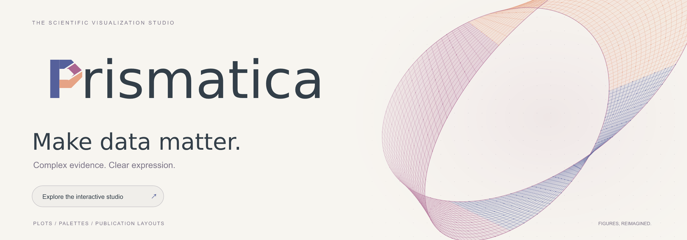
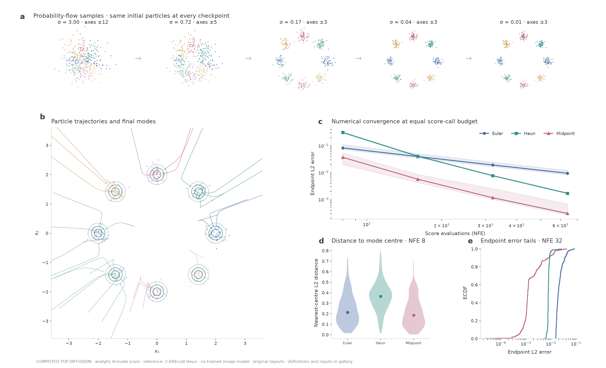
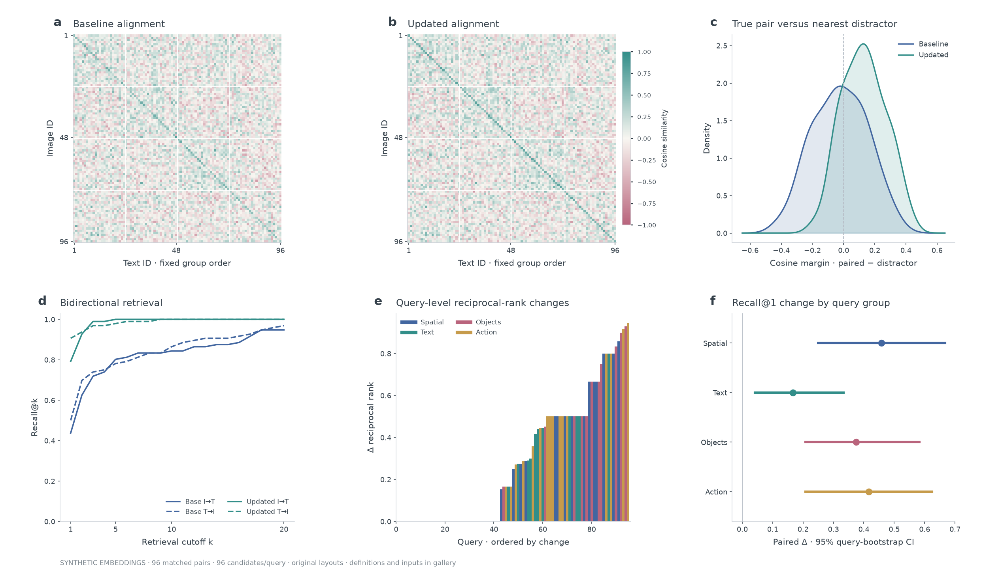
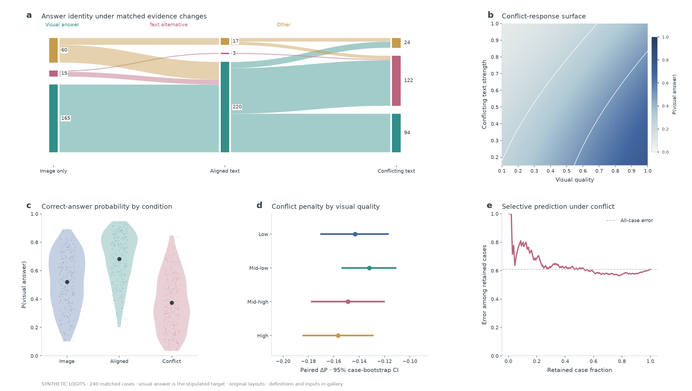

<p align="center">
  <a href="https://grady10086.github.io/Prismatica/"><picture>
    <source media="(prefers-color-scheme: dark)" srcset="docs/homepage/masthead-v2-dark.png">
    
  </picture></a>
</p>
<p align="center"><a href="https://grady10086.github.io/Prismatica/">Interactive studio ↗</a> · <a href="#start-creating">Get started</a> · <a href="docs/gallery.md">Gallery</a> · <a href="docs/usage.md">Guide</a> · <a href="docs/examples.md">Examples</a> · <a href="README.zh-CN.md">简体中文</a></p>

Prismatica is a **complete scientific figure toolkit for AI coding agents**. Bring your data, results or figure draft; use one workflow to choose the visual form, coordinate colors, compose panels, refine the final layout and export editable figures.

**Experiment plots · model analysis · statistical composites · method diagrams · research teasers**

**[Explore the interactive studio →](https://grady10086.github.io/Prismatica/)** · 24 live studies, editable data, palettes and vector export. [How it works](docs/interactive-studio.md).

## Selected work

**Diffusion numerics** · Computed sampling checkpoints, particle trajectories and equal-budget convergence.

[](docs/multimodal-diffusion.md#diffusion-sampling-and-numerics)

**Cross-modal alignment** · Similarity structure, bidirectional retrieval and query-level changes.

[](docs/multimodal-diffusion.md#cross-modal-alignment-and-retrieval)

**Multimodal evidence conflict** · Matched response flows, response surfaces and selective risk.

[](docs/multimodal-diffusion.md#multimodal-evidence-conflict)

[Factorial ablations & model diagnostics →](docs/gallery.md#dense-cs-compositions) · [Full gallery →](docs/gallery.md) · [Paper references & statistical definitions →](docs/multimodal-diffusion.md)

<sub>Original layouts informed by Nature-family figure studies. Multimodal arrays are synthetic; diffusion is a computed 2D analytic-score experiment, not a pretrained image-model evaluation. Editable figures and reproduction commands are included.</sub>

## One workflow, from input to figure

| Plan | Compose | Refine | Deliver |
| --- | --- | --- | --- |
| Choose charts around the research question and available evidence. | Combine data, images and diagrams with consistent visual roles. | Tune palette, hierarchy, spacing and typography at the target paper size. | Export PDF, SVG and PNG with reproducible source code. |

The suite combines [figure making](skills/scientific-figure-making/SKILL.md) and [paper colors](skills/paper-colors/SKILL.md) behind one entrypoint: **[$prismatica](skills/prismatica/SKILL.md)**. Pairing, uncertainty and data provenance remain part of the drawing workflow.

## Start creating

```sh
git clone https://github.com/Grady10086/Prismatica.git
cd Prismatica
python3 scripts/install_skills.py
```

Installs all three skills into `~/.codex/skills/`. Existing folders are preserved; use `--replace` to update with backups. Open a new agent session if needed, then ask:

> Use $prismatica to turn my experiment CSV into a 180 mm multi-panel figure. Show model comparisons and ablations, use a consistent palette, preserve matched seeds, and export PDF, SVG and PNG. Check the layout at its final size.

**[Usage & inputs](docs/usage.md)** · [All examples & reproduction](docs/examples.md) · [Contributing](CONTRIBUTING.md) · [MIT](LICENSE)
