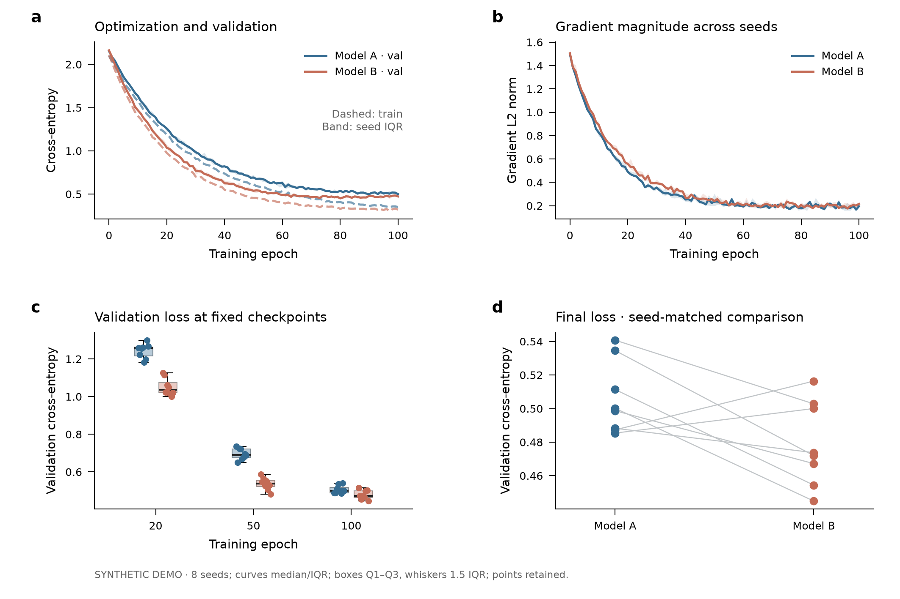
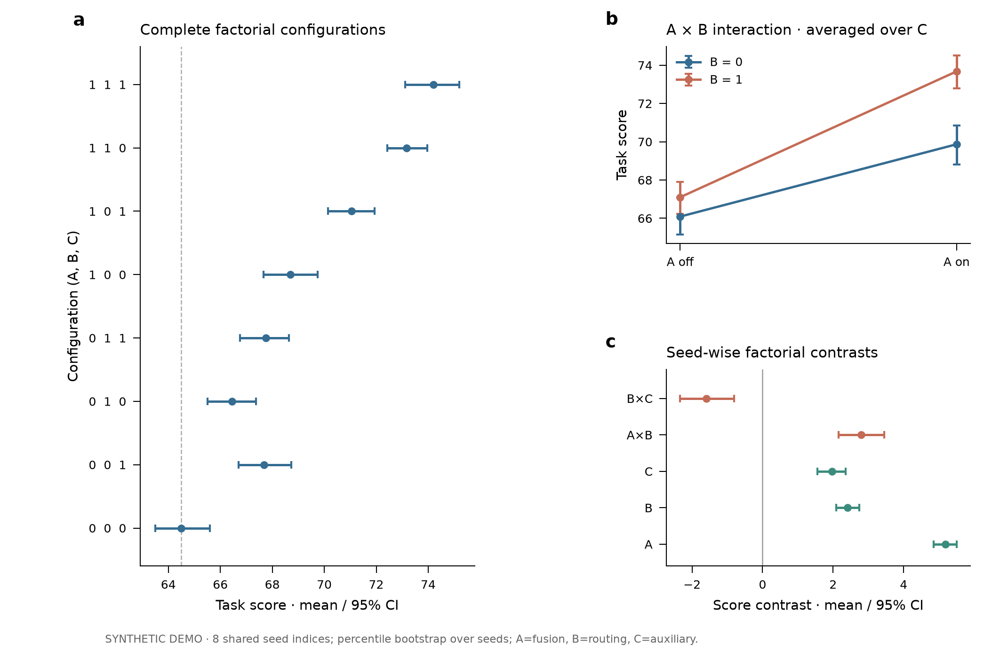

# Scientific Figure Making

科研绘图与论文排版 skill：从实验数据图、复杂组合图，到方法主图与 research teaser。
优先保留数据语义、配对关系和统计口径，再优化可读性与视觉风格。

## Included

- `skills/scientific-figure-making/`: 主 skill、Matplotlib 布局工具、科研统计图与 CS 实验图示例。
- `skills/paper-colors/`: 随包保留的配色伴随 skill，维持示例和测试的相对依赖。
- 紧凑的论文双栏图：训练动态、跨模态检索、消融交互、条件冲突、重建质量与成本。
- 可选 Nature 风格、复杂统计组合、方法 overview、真实论文参考和结果序列排版。

## Preview

These are original layouts rendered from **synthetic demonstration data**.




## Install as a skill

Clone this repository and copy `skills/scientific-figure-making` into your agent's
skills directory. Copy sibling `skills/paper-colors` as well to use all galleries.
Codex's conventional local location is `~/.codex/skills/`; retain the two folders
as siblings. The skill entrypoint is [SKILL.md](skills/scientific-figure-making/SKILL.md).

Example request:

> 使用 scientific-figure-making，把我的实验 CSV 绘制成 180 mm 双栏组合图，
> 保留逐种子数据，标明置信区间，导出 PDF、SVG 和 PNG。

## Run examples

With Python 3.10+ and uv:

```sh
uv sync --all-extras
uv run python skills/scientific-figure-making/examples/cs_paper_data_gallery.py --out /tmp/paper-data
uv run python skills/scientific-figure-making/examples/cs_paper_comparisons.py --out /tmp/paper-comparisons
uv run pytest -q
```

Both example galleries above use **explicitly synthetic data**, not published
benchmark measurements. More commands and chart-specific guidance are in the
[gallery catalog](skills/scientific-figure-making/references/gallery-catalog.md).
Paper-reference scripts require separately supplied local PDFs; they do not run
model inference. Output labels distinguish fixtures, local demo runs, published
numerical redraws and original-source excerpts.

## Publication workflow

Choose the claim and venue → load real data → choose plots and uncertainty →
set final dimensions → export vectors → inspect at insertion size. No chart
styling should change results, hide losing cases or add unsupported significance.

## Sources and license

This repository packages work developed while extending
[ruixuan-ray-zhang/beautify](https://github.com/ruixuan-ray-zhang/beautify).
Upstream authorship and MIT license are preserved; see [NOTICE](NOTICE.md).
Original paper PDFs, extracted paper illustrations, proprietary Pantone color
books, personal files and temporary previews are not included. References link
to their sources; third-party visual/data rights remain with their owners.
