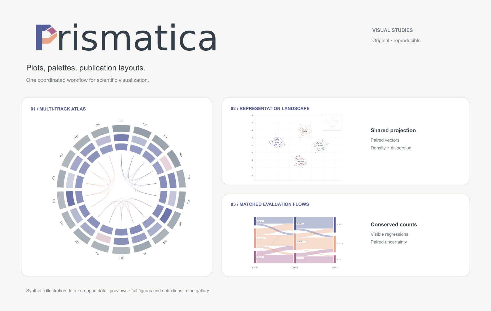
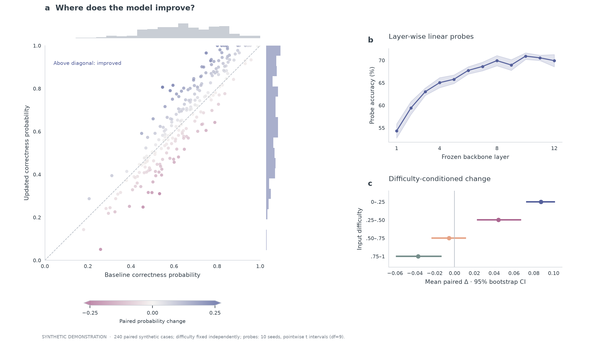
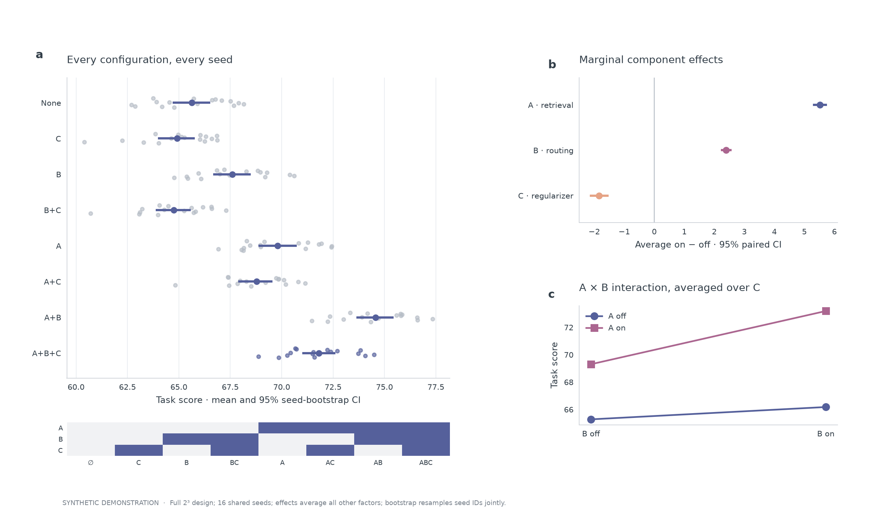
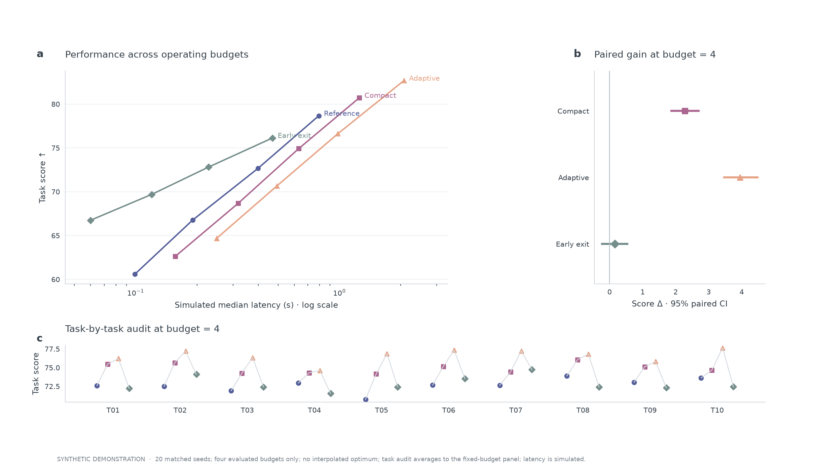

<p align="center">
  <picture>
    <source media="(prefers-color-scheme: dark)" srcset="docs/gallery/cover-dark.png">
    
  </picture>
</p>
<p align="center"><strong>A visual toolkit for research.</strong><br>Plots, palettes and publication layouts — one coordinated skill workflow.</p>
<p align="center"><a href="docs/gallery.md">Gallery</a> · <a href="#quick-start">Quick start</a> · <a href="docs/usage.md">Usage</a> · <a href="docs/examples.md">All examples</a> · <a href="README.zh-CN.md">简体中文</a></p>

## See what you can make

### CS experiment studies

Model behavior, full-factorial ablations and performance comparisons — three compositions with paired evidence, explicit uncertainty and visible regressions.

[](docs/gallery.md#cs-model-analysis)

<table>
<tr>
<td width="50%"><a href="docs/gallery.md#cs-factorial-ablation"></a></td>
<td width="50%"><a href="docs/gallery.md#cs-performance-audit"></a></td>
</tr>
<tr><td><strong>Factorial ablation</strong><br>Eight configurations, seed distributions and interactions.</td><td><strong>Performance audit</strong><br>Latency trade-offs, paired effects and task-level detail.</td></tr>
</table>

### More visual compositions

[](docs/gallery.md#multi-track-task-fingerprint)

Explore [representation landscapes](docs/gallery.md#representation-landscape), [matched evaluation flows](docs/gallery.md#matched-evaluation-flows), [paired estimation](docs/gallery.md#paired-estimation) and more in the **[nine-design gallery →](docs/gallery.md)**.

All previews use **synthetic demonstration data**, not benchmark results. Complete figures, statistical definitions, editable SVGs and reproduction commands are included. Gallery masters need typography adapted to the target paper width.

## What Prismatica does

Prismatica is a skill suite for an AI coding agent. It helps choose a chart, apply a coherent palette, build the figure with code, inspect its final size and deliver editable outputs.

| Your task | What the workflow emphasizes |
| --- | --- |
| Training runs, ablations and model comparisons | Matched runs, defined uncertainty, honest axes and visible losing cases |
| Multimodal and diffusion experiments | Retrieval, condition conflicts, reconstruction metrics and compute budgets |
| Statistical compositions | Distributions, clustering, correlations, flows, spatial views and inference |
| Method overviews and research teasers | Actual mechanisms and inputs/results, clear hierarchy and linked crops |
| Palette and publication formatting | Semantic color roles, accessible series, venue dimensions and vector export |

The three bundled skills work together:

- **[`prismatica`](skills/prismatica/SKILL.md)** — one entrypoint for the full workflow.
- **[`scientific-figure-making`](skills/scientific-figure-making/SKILL.md)** — composition, statistics, layout and export.
- **[`paper-colors`](skills/paper-colors/SKILL.md)** — color books, themes, ramps and color checks.

## Quick start

Install all three skills into your agent’s skill directory:

```sh
git clone https://github.com/Grady10086/Prismatica.git
cd Prismatica
python3 scripts/install_skills.py
```

The default destination is `~/.codex/skills/`. Existing installations are preserved: use `--dest` for another directory or `--replace` to update with backups. Start a new agent session if the skills are not yet listed.

Then ask:

> Use $prismatica to turn my experiment CSV into a double-column figure. Compare the models using matched seeds, show the appropriate uncertainty, keep method colors consistent, and export PDF, SVG and PNG. Inspect the result at its intended paper width.

[More example requests and input expectations →](docs/usage.md)

## Reproduce the gallery

Python 3.10+ and [uv](https://docs.astral.sh/uv/):

```sh
uv sync --all-extras --locked
uv run python skills/scientific-figure-making/examples/showcase_gallery.py --out /tmp/prismatica-gallery
uv run python skills/scientific-figure-making/examples/cs_showcase.py --out /tmp/prismatica-cs
uv run pytest -q
```

The gallery command exports PNG/PDF/SVG, the synthetic arrays and a provenance record. The suite also retains all earlier galleries, layout utilities and paper-specific references. [Browse every example →](docs/examples.md)

## Evidence stays intact

Styling must preserve the experiment. Prismatica distinguishes synthetic fixtures, actual local demo-model results, published-value redraws and original-paper excerpts. It keeps sample pairing, uncertainty definitions and split denominators explicit. Paper-reference scripts require separately supplied source PDFs; original illustrations and proprietary color books are not bundled.

The Iris logo palette is documented in [brand assets](docs/brand). Brand colors are not automatically a suitable palette for every scientific comparison.

## Contributing

Contributions can improve a plotting primitive, add a coherent composition, expand an evidence-grounded reference or fix final-size readability. Include provenance and a reproducible preview. [Development and review checklist →](CONTRIBUTING.md)

## Credits & license

Developed while extending [ruixuan-ray-zhang/beautify](https://github.com/ruixuan-ray-zhang/beautify). Upstream MIT authorship is retained in [LICENSE](LICENSE) and [NOTICE](NOTICE.md). Referenced papers and third-party data retain their own rights. The project is not affiliated with or endorsed by Pantone LLC.
