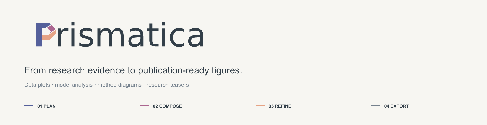
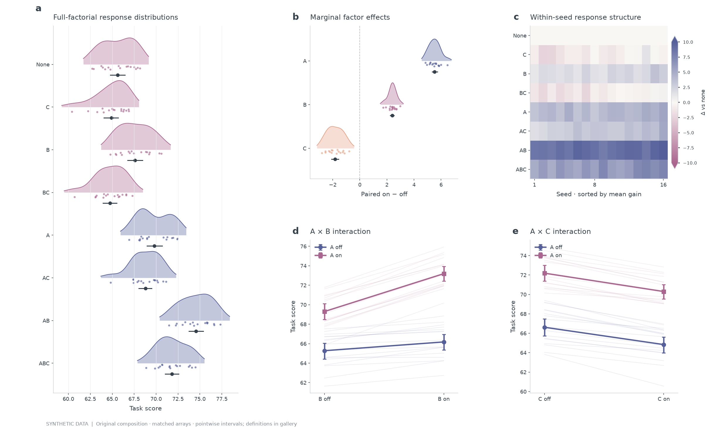
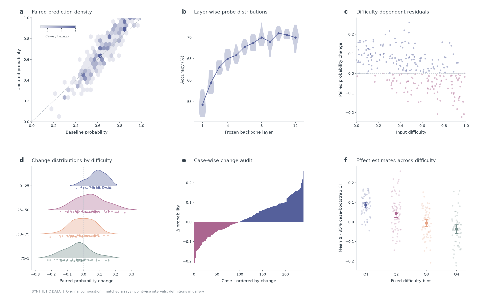
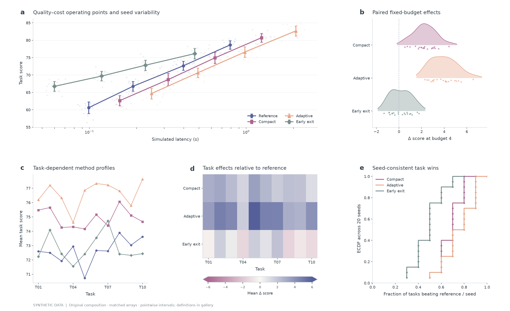

<p align="center">
  <picture>
    <source media="(prefers-color-scheme: dark)" srcset="docs/homepage/masthead-dark.png">
    
  </picture>
</p>
<p align="center"><a href="#开始绘图">开始使用</a> · <a href="docs/gallery.md">精选画廊</a> · <a href="docs/usage.md">使用指南</a> · <a href="docs/examples.md">全部示例</a> · <a href="README.md">English</a></p>

Prismatica 是面向 AI 编程助手的**完整科研绘图工具套件**。提供实验数据、结果素材或已有草图，即可通过统一工作流完成选图、配色、组合排版、最终尺寸检查与可编辑导出。

**实验数据图 · 模型分析 · 复杂统计组合 · 方法主图 · 科研 teaser**

## 精选展示

**因子消融** · 种子分布、组件效应与交互结构。

[](docs/gallery.md#dense-cs-compositions)

**模型诊断** · 预测密度、逐层探针、难度切片与失败样本。

[](docs/gallery.md#dense-cs-compositions)

**性能评测** · 成本曲线、配对效应、任务分布与种子一致性。

[](docs/gallery.md#dense-cs-compositions)

[完整画廊与可编辑图形 →](docs/gallery.md)

<sub>以上为使用合成演示数据的原创组合。统计定义与复现命令见画廊。</sub>

## 从输入到成图

| 选图 | 组合 | 精修 | 交付 |
| --- | --- | --- | --- |
| 根据研究问题与已有证据选择图形。 | 将数据、图像与方法结构组织成连贯面板。 | 在论文实际尺寸下调整配色、层级、留白与字体。 | 导出 PDF、SVG、PNG 与可复现代码。 |

通过 **[$prismatica](skills/prismatica/SKILL.md)** 统一调用[绘图与排版](skills/scientific-figure-making/SKILL.md)、[论文配色](skills/paper-colors/SKILL.md)。样本配对、不确定性定义与数据来源贯穿绘图过程。

## 开始绘图

```sh
git clone https://github.com/Grady10086/Prismatica.git
cd Prismatica
python3 scripts/install_skills.py
```

一次安装三个 skill，默认位置为 `~/.codex/skills/`。已有目录会保留；更新可使用 `--replace` 并自动备份。必要时开启新的助手会话，然后提出需求：

> 使用 $prismatica，把我的实验 CSV 做成 180 mm 多面板论文图，展示模型对比和消融实验。统一配色，保留逐种子配对，导出 PDF、SVG、PNG，并检查最终尺寸的排版。

**[使用方式与输入要求](docs/usage.md)** · [全部示例与复现](docs/examples.md) · [参与贡献](CONTRIBUTING.md) · [MIT](LICENSE)
