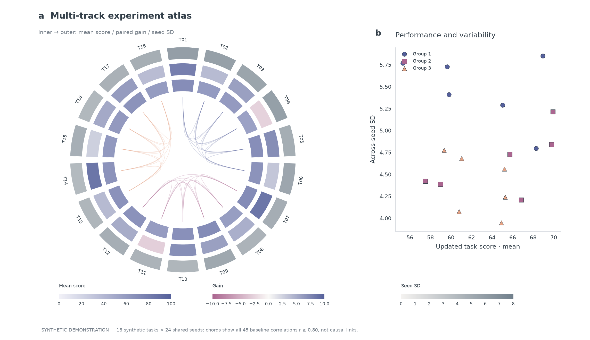
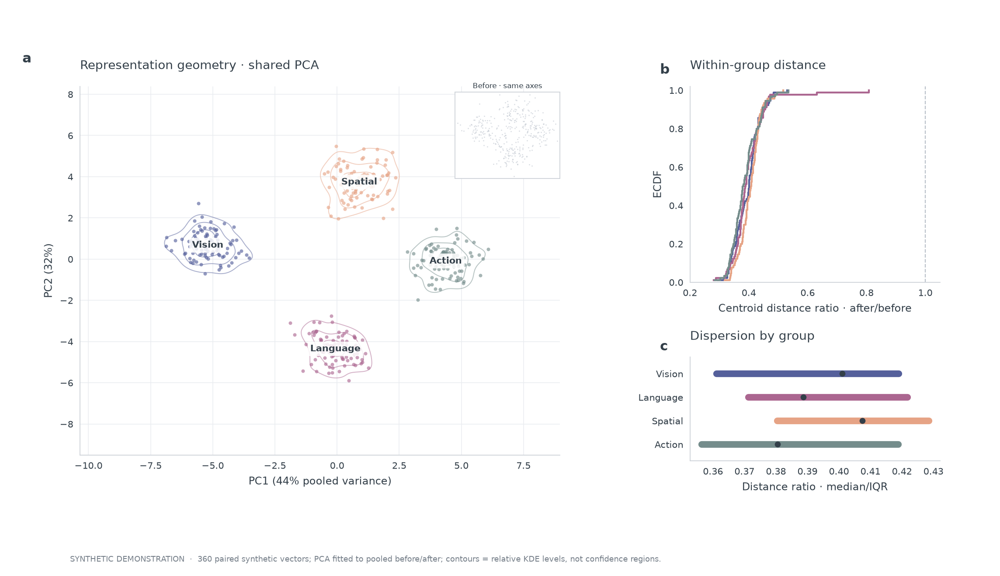
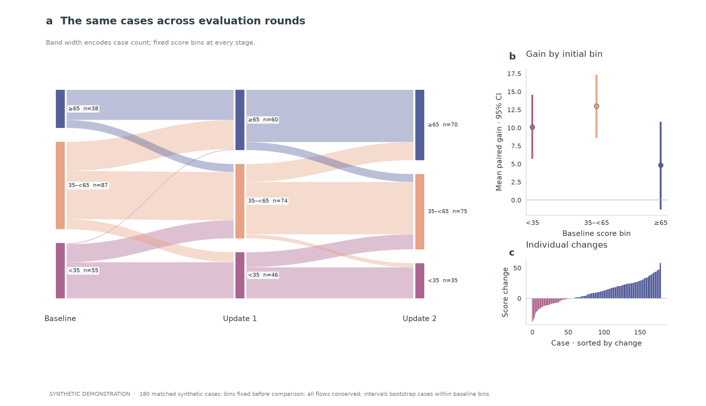
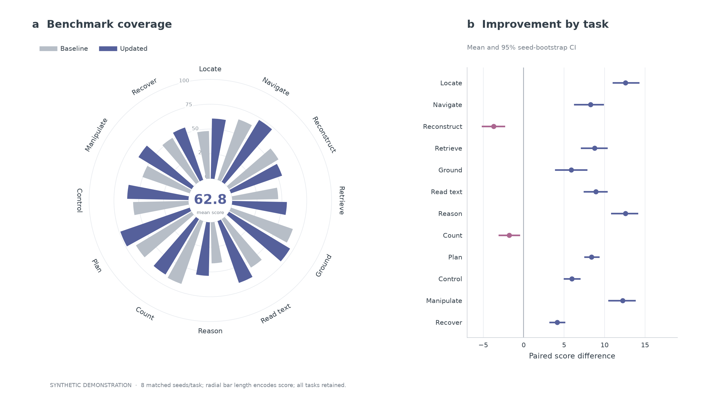
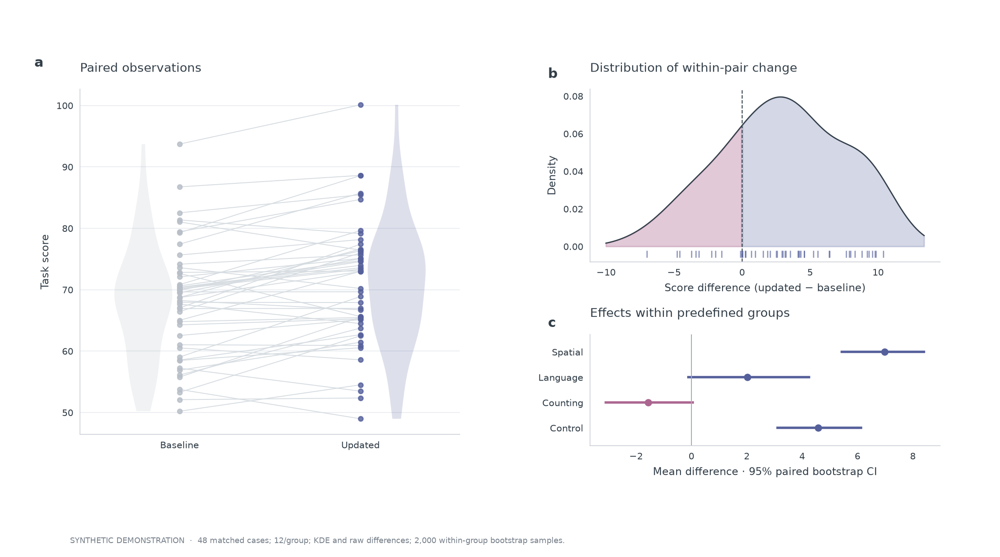
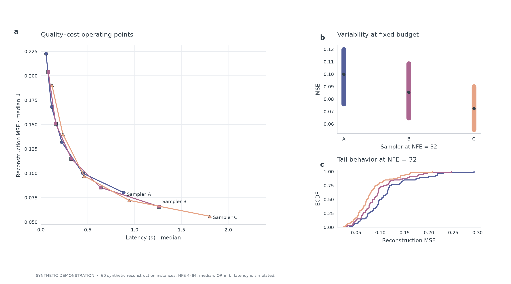

# Selected gallery

Six deliberately different compositions. These are original gallery designs with **synthetic inputs**, not screenshots from papers or performance claims. The readable gallery masters are 10.4 × 5.8–6 inches; adjust font sizes and dimensions for a specific manuscript venue.

## Multi-track task fingerprint



- 18 synthetic tasks, 24 shared seeds. Inner ring: updated mean (0–100); middle: paired gain (−10 to 10); outer: updated across-seed SD (0–8). Each track has its own explicit color scale.
- Chords include every baseline run-level task correlation with r ≥ 0.80; they show association, not causation. Correlations use the same shared-seed arrays.
- The companion scatter compares updated mean with seed variability, using group colors and distinct markers.
- **Use for:** multi-task profiles with stability and related task families. Read precise values from Cartesian panels rather than chord geometry.
- [Editable SVG](gallery/circular-fingerprint.svg)

## Representation landscape



- 360 paired synthetic 6D vectors across four predefined groups. PCA is fitted once to pooled before/after vectors; the main view and before inset share projection and axis limits.
- Contours are per-group KDE levels at 15%, 40% and 75% of peak density, **not confidence regions**. Relative levels do not encode equal probability mass.
- ECDFs and median/IQR intervals summarize after/before distance-to-group-centroid ratios in the original 6D space. Centroids are estimated from the displayed groups; projection separation alone is not evidence of representation quality.
- **Use for:** paired representation changes with a high-dimensional quantitative companion. Replace the fixture with actual embeddings and validate the relevant downstream metric.
- [Editable SVG](gallery/representation-landscape.svg)

## Matched evaluation flows



- The same 180 synthetic cases appear in three evaluation rounds. Fixed score bins are <35, 35–<65 and ≥65. Ribbon widths encode counts; every transition conserves its source and destination marginals.
- Side panels retain individual regressions and mean paired final-minus-initial changes by initial bin. Intervals are 95% percentile bootstraps over cases within each initial bin (2,000 resamples), not independent-run uncertainty.
- Initial-bin comparisons are descriptive and can be affected by regression to the mean. They do not establish subgroup treatment effects.
- **Use for:** tracking case transitions with consistent thresholds and case identities.
- [Editable SVG](gallery/evaluation-flow.svg)

## Benchmark atlas



- **Left:** baseline and updated means across 12 synthetic tasks; common radial offset, linear bar-length scale, no area encoding. The center is the equally weighted mean updated task score.
- **Right:** within-seed score changes for the same tasks. Points are mean paired changes; intervals are 95% percentile bootstrap CIs over eight shared seeds (2,000 resamples). Negative effects remain visible.
- **Use for:** a broad task inventory with a precise effect panel beside the overview. For fine ranking alone, use Cartesian comparisons.
- [Editable SVG](gallery/benchmark-atlas.svg)

## Paired estimation



- All 48 synthetic observations retain their before/after pairing. Offset violins summarize distributions without replacing the raw points.
- The KDE is descriptive; the rug shows each observed difference. Negative and positive regions share the same density estimate.
- Group intervals are 95% percentile bootstraps of paired changes within four predefined groups (12 cases/group). These are pointwise, not multiplicity-adjusted intervals.
- **Use for:** repeated measurements, per-query model changes and subgroup estimates. Groups must not be selected after examining the desired outcome.
- [Editable SVG](gallery/paired-estimation.svg)

## Quality and cost



- Three synthetic samplers at NFE 4/8/16/32/64; the left panel connects only evaluated operating points. Latency is simulated, not hardware-measured.
- The fixed-budget panel shows median/IQR across 60 instances; the ECDF retains the whole error distribution. Distinct markers supplement the colors.
- **Use for:** paired-target reconstruction with an appropriate MSE definition. It is not an unconditional text-to-image quality evaluation; no Pareto or significance claim is inferred.
- [Editable SVG](gallery/quality-cost.svg)

## Reproduce

From the repository root:

```sh
uv sync --all-extras --locked
uv run python skills/scientific-figure-making/examples/showcase_gallery.py --out /tmp/prismatica-gallery
uv run python skills/scientific-figure-making/examples/advanced_showcase.py --out /tmp/prismatica-advanced
uv run python scripts/build_gallery_cover.py --gallery /tmp/prismatica-advanced --out /tmp/prismatica-cover
```

Each figure script outputs three PNG/SVG/PDF figures, `showcase-inputs.npz` or `advanced-inputs.npz`, and `provenance.json` with the random seed and fixture status. Replace the data generation blocks with actual measurements and recompute all derived panels before publication.

## Beyond this selection

The [full example index](examples.md) covers statistical composites, manuscript experiments, method overviews and image-led teasers. Those modes have different goals and visual conventions. Earlier [training](images/training-dynamics.png) and [factorial](images/factorial-interactions.png) fixtures remain available for regression/reference, but are no longer the homepage showcase.
