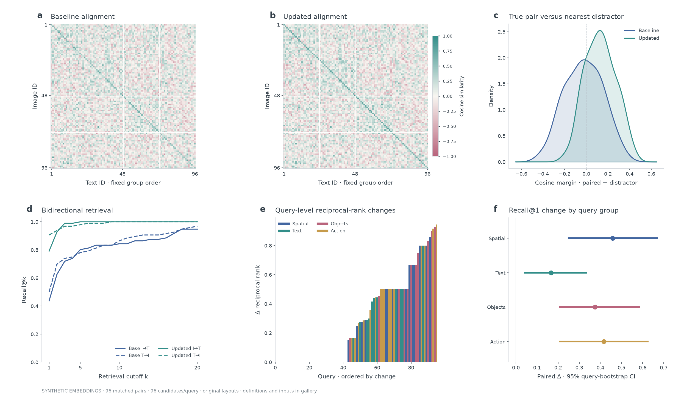
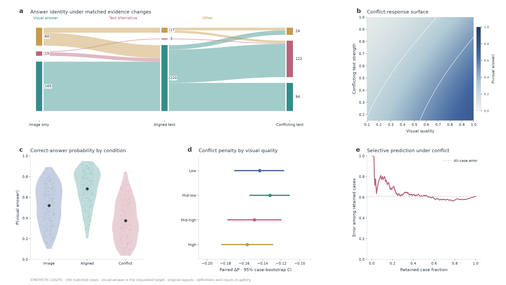
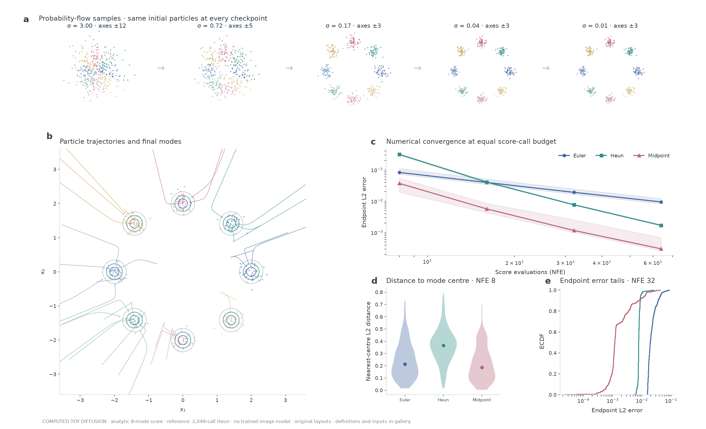

# Multimodal and diffusion studies

Three original, tightly composed studies for vision–language and generative-model experiments. These are templates with explicit evidence definitions: **synthetic embeddings/logits** in the multimodal studies; **computed numerical integrations on a synthetic distribution** in the diffusion study. No pretrained MLLM or image diffusion model is evaluated. Replace each data source and recompute every derived panel for a real paper.

## Source studies

- [EyeCLIP, npj Digital Medicine (2025), Fig. 5](https://www.nature.com/articles/s41746-025-01772-2): inspected the published figure's organization of retrieval directions, cutoffs, datasets and paired qualitative evidence. Our plate uses query-level numerical diagnostics rather than the paper's medical images or scores.
- [Optical generative models, Nature (2025), Figs. 2–3](https://www.nature.com/articles/s41586-025-09446-5): inspected the published process/result compositions, especially ordered sampling stages and the relationship between mechanism and outputs. Our numerical score experiment is original and does not simulate an optical device.
- The evidence-conflict plate is an original extension for MLLM-style evaluation. It is **not** a redraw of a Nature result. Answer classes and the visual target are stipulated by the synthetic fixture.

The references inform composition and evidence organization. Their paper figures are not bundled. Original input arrays, computed ranks, probabilities and numerical trajectories are exported separately by the script.

## Cross-modal alignment and retrieval



- **a–b:** 96 matched image/text vectors in 24 dimensions; all 96 candidates are retained for every query. L2-normalized embeddings yield cosine matrices on the same fixed −1 to 1 scale. Group ordering stays fixed; it is not selected by the desired outcome. Text noise changes between baseline and updated embeddings, with the same underlying pair identities.
- **c:** each image-query's true-pair cosine minus its largest non-paired cosine. Gaussian KDEs are descriptive; zero separates successful top-1 ordering from distractor dominance.
- **d:** image-to-text and text-to-image Recall@k, computed from row and column ranks of those matrices. Solid/dashed lines distinguish directions, colors distinguish versions. All metrics use the same single matching target per query; there is no pooled class-level positive definition.
- **e:** updated-minus-baseline reciprocal rank for every image query, ordered by change. Colors identify four predefined query groups. Zero changes and regressions remain in the array; repeated ranks are not jittered to appear distinct.
- **f:** mean paired Recall@1 changes within each group (24 queries/group), with pointwise 95% percentile bootstrap intervals over matched query IDs, 2,000 resamples. These do not include retraining uncertainty or multiplicity correction.
- [Editable SVG](gallery/multimodal-retrieval.svg)

## Multimodal evidence conflict



- **a:** 240 identical case IDs across image-only, aligned-text and conflicting-text conditions. Argmax of each case's three response logits determines a categorical answer. The alluvial widths encode counts and conserve every adjacent-stage marginal. Colors are fixed answer identities: visual answer, alternative text answer, other. Ribbons preserve adjacent-stage transitions; they do not encode persistent sub-ribbon identity across all three columns.
- **b:** a deterministic response surface from the same conflict logit formula with the shared per-case noise set to zero. The visual-quality and text-strength grid is **not** an empirical confidence surface. White contours indicate P(visual answer) = .25/.50/.75.
- **c:** within-condition KDE violins, raw probability values and mean points. Width is a descriptive density, not a confidence interval.
- **d:** conflicting-text minus image-only P(visual answer), grouped by four fixed visual-quality bins over [.1, 1]. Pointwise 95% paired case-bootstrap intervals use 2,000 resamples; the horizontal axis is tightened to the displayed effects.
- **e:** rank conflict cases by maximum softmax probability, then calculate cumulative error among retained cases. The visual answer is the stipulated target; confidence is not assumed calibrated. The dashed line is all-case error. This is descriptive, with no threshold fitted on an independent validation split.
- [Editable SVG](gallery/multimodal-conflict.svg)

## Diffusion sampling and numerics



This is an actual computation of the **variance-exploding probability-flow ODE** on a known 2D mixture of eight equally weighted isotropic Gaussians. Mode centres sit on a radius-2 ring, component SD = .16. The analytic marginal score is available at every noise scale. No learned denoiser, training run or image generation is implied.

- Initialize 384 particles from the exact mixture marginal at sigma = 3 and integrate `dx/dsigma = -sigma × score(x, sigma)` down to sigma = .01 using a geometric sigma grid. The endpoint is the finite-noise marginal, not exactly sigma = 0.
- **a:** five checkpoints from the same 32-score-call Heun run. Each small plot explicitly labels its own symmetric axis limits; the zoom changes to retain legibility while enclosing every particle. Colors track the same particle's nearest final mode, not its initialization mixture label.
- **b:** a fixed central viewport shows 32 deterministically selected trajectories (every third of the first 96 particles), all final samples and unnormalized analytic endpoint density contours at .1/.35/.7. Paths outside the ±3.6 viewport are clipped; complete paths remain in the NPZ. Trajectory colors retain final-mode identity.
- **c:** Euler, Heun and midpoint use equal **score evaluation counts**, NFE 8/16/32/64. Two-stage methods take NFE/2 integration steps. Lines show median endpoint L2 error across particles against a same-start **2,048-score-call Heun reference**; shading is particle IQR, not confidence intervals. This measures discretization error, not perceptual quality, likelihood, FID or distance to a true paired image.
- **d:** nearest-mode-centre distances at NFE 8; violins summarize the 384 particles and dots mark medians. This is a geometric diagnostic, not a distribution-quality score; collapsing to centres could improve it without matching the target variance.
- **e:** endpoint error ECDFs at NFE 32 retain the full particle distribution. A finer-reference check (2,048 versus 4,096 score calls) gives median endpoint difference 1.11 × 10⁻⁶ and maximum 1.06 × 10⁻⁵ for this fixture. On the first 64 particles, the next refinement (4,096 versus 8,192 calls) reduces the median difference to 0.249 times the previous one. Analytic-score finite differences additionally validate the ODE implementation.
- [Editable SVG](gallery/diffusion-numerics.svg)

## Reproduce

```sh
uv sync --all-extras --locked
uv run python skills/scientific-figure-making/examples/multimodal_diffusion_plate.py --out /tmp/prismatica-multimodal
```

Outputs: three PNG/SVG/PDF figures, `multimodal-diffusion-inputs.npz` and `provenance.json`. Random seed: 1107. Gallery masters are 11.5 × 6.5–7 inches; adapt typography and panel count to the actual paper width.

The chart palette uses cobalt `#4266A0`, teal `#328E89`, berry `#B9647C` and muted gold `#C69B4B`, with explicit semantic roles per panel. Series also use line styles, markers, labels or positions; brand colors do not determine every numerical color scale.
