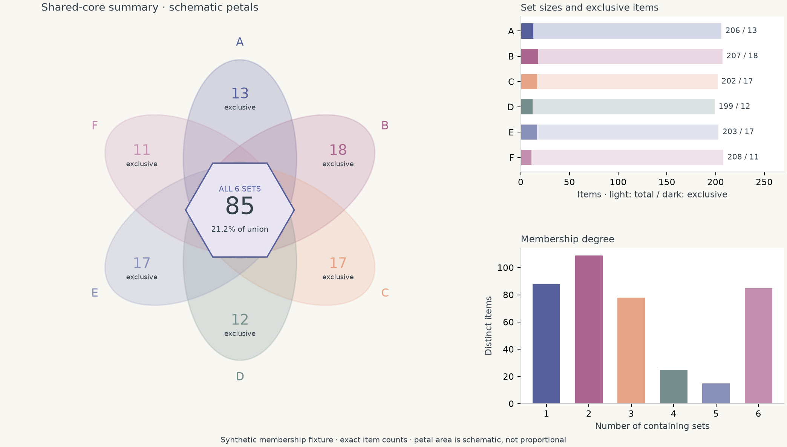

# Set overlap and shared cores

[Open the flower summary](https://grady10086.github.io/Prismatica/#lab/set-flower) · [UpSet](https://grady10086.github.io/Prismatica/#lab/set-upset) · [Jaccard](https://grady10086.github.io/Prismatica/#lab/set-similarity)



Three original compositions share exact membership statistics. They can describe
gene families or, in CS, samples solved by different models, retrieved document
sets, or training-data overlap. The default memberships are synthetic fixtures.

- **Flower:** all-six shared core, each set's exclusive count, set totals and the
  distribution of membership degree. Petals have decorative fixed geometry;
  this is neither an area-proportional diagram nor a full six-set Venn diagram.
- **UpSet:** non-empty exclusive intersections, sorted by count. Marked rows mean
  present and unmarked rows mean absent. Top-k omission is reported explicitly.
- **Jaccard:** inclusive pairwise overlap / pairwise union, a weighted network and
  the six largest inclusive pair counts. Two empty sets have undefined Jaccard (—).
  Pairwise counts include higher-order overlaps and do not partition the union.

## Online data format

Use `item,A,B,C,D,E,F`, with one unique integer ID per row and six binary 0/1
memberships. At least one set must contain each item. The browser excludes no
items silently. Zero-sized sets and a zero shared core are permitted. The four
metrics report union size, all-six core, one-set-only items and non-empty exact
intersections. Default parameter changes regenerate the seeded fixture; importing
CSV or JSON replaces it. Example:

```csv
item,A,B,C,D,E,F
1,1,0,0,0,0,0
2,0,1,0,0,0,0
3,1,1,0,0,0,0
4,1,1,1,1,1,1
```

This has union 4, core 1, two one-set-only items, and Jaccard(A,B) = 2/4.
Click petals, exact-intersection columns or pairwise cells/edges to pin their
linked marks. The same set/pattern/pair identity is retained across linked panels.
The petal centre exposes core count and its percentage of the distinct union.

## Python and reusable skill

The bundled [set overlap guide](../skills/scientific-figure-making/references/set-overlap.md)
selects between representations and documents the data rules. The
[script](../skills/scientific-figure-making/scripts/set_overlap.py) accepts string
item IDs and arbitrary names for 2–6 sets:

```sh
uv run python skills/scientific-figure-making/scripts/set_overlap.py --demo --out /tmp/set-overlap
uv run python skills/scientific-figure-making/scripts/set_overlap.py --csv memberships.csv --out figures/sets
```

Each run exports three compositions in PNG/SVG/PDF plus exact-intersection CSV
and summary JSON. Layouts are gallery-sized masters; adjust the size and text for
a manuscript. The Python demo uses Python's seeded RNG; browser presets use the
browser RNG, so their synthetic observations differ. Imported identical member
tables yield identical counts in both implementations.

References: [UpSet (Lex et al., 2014)](https://www.visdesignlab.net/publications/2014_infovis_upset/), [Intervene (Khan & Mathelier, 2017)](https://link.springer.com/article/10.1186/s12859-017-1708-7). No source-paper figures or screenshot counts are reproduced.
